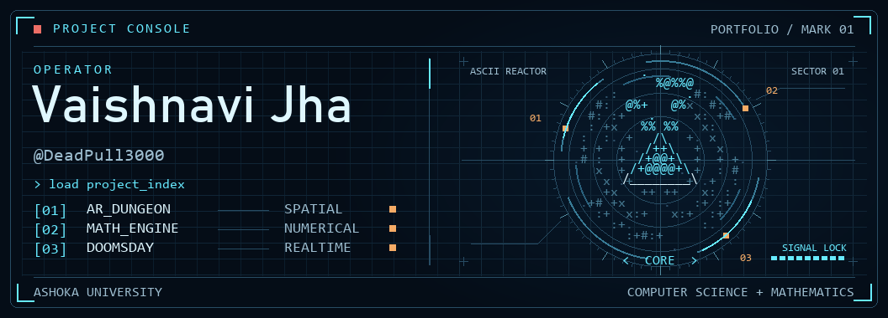
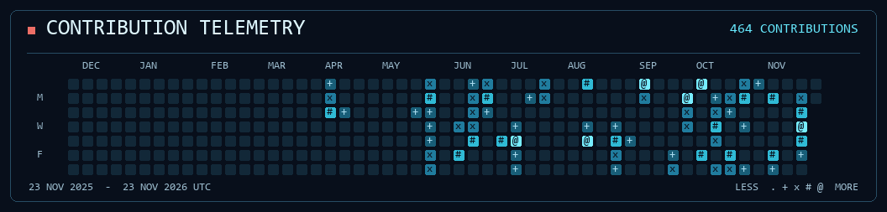
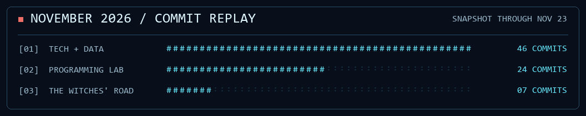

<picture>
  <source media="(prefers-reduced-motion: no-preference)" srcset="./hud-boot.gif">
  
</picture>

# Vaishnavi Jha

**Computer Science & Mathematics · Ashoka University**

I build tools that make complex systems easier to see, explore, and learn. My projects span mathematical visualization, augmented reality, robotics education, and software for live events.

[Project radar](#project-radar) · [Contribution activity](#contribution-activity) · [All repositories](https://github.com/DeadPull3000?tab=repositories)

## ⌁ Project radar

- **[AR Dungeon](https://github.com/DeadPull3000/AR_Dung)** · *Kotlin · ARCore*  
  Turns ARCore depth data into an occupancy grid for obstacle-aware A\* navigation and gameplay in physical spaces.
- **[Visual Mathematical Discovery Engine](https://github.com/DeadPull3000/mathematics_visualizer)** · *Python · React*  
  An interactive workbench for graph spectra, persistent homology, and geometry, with visualizations from persistence barcodes to surface meshes.
- **[Road to Doomsday](https://github.com/DeadPull3000/tech-and-data/tree/main/road-to-doomsday)** · *Node.js · Express · WebSockets*  
  Built the mobile buzzer, quizmaster console, and projector display for a live quiz with **41 participating teams**.

## ⟐ More from the lab

- **[Ronnie LearnIDE](https://github.com/DeadPull3000/Ronnie_LearnIDE)** maps firmware lines to robot components and servo motion. Students used it in Ashoka’s Young Scholars Programme.
- **[Programming Lab](https://github.com/DeadPull3000/Programming_Lab)** explores tries, prefix-pruned search, and feedback-based guess ranking through Rust word games.
- **[UnHinged](https://github.com/DeadPull3000/UnHinged)** generates laser-cut hinge patterns as parameterized, millimeter-scale SVGs.

## ◇ Beyond the code

I lead Tech & Data for Ashoka’s Quizzing Club, mentor newcomers at the Makerspace, and build resources that help students connect code to hardware.

## ◈ Contribution activity

<picture>
  <source media="(prefers-reduced-motion: no-preference)" srcset="./activity-scan.gif">
  
</picture>

Each square represents one day. Brighter squares mark more contributions. [Replay the scan](./activity-scan.gif?raw=true) · [View GitHub’s calendar and activity timeline](https://github.com/DeadPull3000#js-contribution-activity)

Replay the November 2026 commit activity snapshot

<picture>
  <source media="(prefers-reduced-motion: no-preference)" srcset="./commits-replay.gif">
  
</picture>

GitHub’s public profile listed **77 commits** across [Tech & Data](https://github.com/DeadPull3000/tech-and-data/commits?author=DeadPull3000&since=2026-11-01&until=2026-11-24) (46), [Programming Lab](https://github.com/DeadPull3000/Programming_Lab/commits?author=DeadPull3000&since=2026-11-01&until=2026-11-24) (24), and [The Witches’ Road](https://github.com/DeadPull3000/witches_road_login/commits?author=DeadPull3000&since=2026-11-01&until=2026-11-24) (7) in its November summary through November 23.

[Replay the animation](./commits-replay.gif?raw=true)

## ⊞ Project archive

- **Interactive systems** · [The Witches’ Road](https://github.com/DeadPull3000/witches_road_login) · [PokeProd](https://github.com/DeadPull3000/PokeProd)
- **Data and models** · [ShadePath](https://github.com/DeadPull3000/the_shady_side) · [ML Systems](https://github.com/DeadPull3000/Machine-Learning-Systems-course-) · [Gemini narration](https://github.com/DeadPull3000/gsoc-gemini-pokemon-narration)
- **Hardware and learning** · [YSP TDCS](https://github.com/DeadPull3000/TDCS) · [Ultrasonic proximity LEDs](https://github.com/DeadPull3000/UltrasonicSensor_ControlledLED)

How the HUD works

The reactor is drawn on a fixed-width ASCII grid. A moving sweep lights up the characters while the console reveals each project signal. The activity panel reads the day counts visible to a signed-out visitor. [HUD renderer](./render_hud.py) · [Activity renderer](./render_activity.py)

